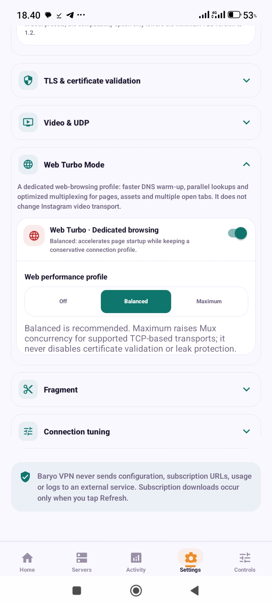

# BaryoVPN

### A polished Android VPN client for organized, reliable everyday connections

[Download the latest APK](https://github.com/Anooshacavin/BaryoVPN-Android/releases/latest) · [Report a bug](https://github.com/Anooshacavin/BaryoVPN-Android/issues/new?template=bug_report.md) · [Security](SECURITY.md)

---

## About BaryoVPN

BaryoVPN is a focused Android VPN client built around a clean, practical workflow: add your sources, organize your profiles, choose a connection, and keep an eye on connection activity without unnecessary clutter.

This repository is the **public distribution hub** for the application. It is intentionally separate from other projects and contains user-facing release materials only. The application source code and private implementation details are not published here.

## What you can do

| | Feature | Why it matters |
|---|---|---|
| ◈ | **Organized server center** | Keep individual profiles and subscription groups easy to browse. |
| ↻ | **Subscription refresh** | Refresh a source on demand and review imported, skipped and changed profiles. |
| ✓ | **QR workflow** | Scan a supported QR code and receive a clear green confirmation before continuing. |
| ⌁ | **Modern import tools** | Paste, copy, scan and validate subscription links in one focused screen. |
| ◉ | **Connection activity** | Review connection state, traffic and local diagnostic events in one place. |
| ◇ | **Performance-minded UI** | Designed to remain comfortable with large profile collections. |

## Latest release

### BaryoVPN 2.28.7 · Build 259

The latest release adds a polished QR success confirmation: after a valid scan, BaryoVPN shows its logo, a green verification checkmark and a short validation message before continuing to the next step.

It also includes the redesigned Subscription Center with one-tap copy and paste, QR scanning, smart naming, HTTPS preview and safer form feedback.

**[Download BaryoVPN 2.28.7 for Android](https://github.com/Anooshacavin/BaryoVPN-Android/releases/latest)**

## Why is the APK large?

The APK is larger than a small utility app because it is a **standalone release**. It includes the Android runtime, the cross-platform UI bundle, native networking components, bundled resources and compatibility data needed to install and run without a development server or an additional desktop setup.

This is intentional:

- The app works as a direct install instead of depending on Metro or a local development machine.
- Native components are packaged for Android compatibility and runtime stability.
- The release contains the assets required for the complete UI and connection workflow.
- A single universal APK is convenient for users, but is larger than architecture-specific split packages.

The APK size is therefore a distribution trade-off, not an indication that the app is downloading user data or silently bundling private subscriptions. The public release page is the recommended place to download it because GitHub Release assets support large files cleanly and preserve version history.

## Install

1. Open the [latest Releases page](https://github.com/Anooshacavin/BaryoVPN-Android/releases/latest).
2. Download the APK asset.
3. Allow installation from your browser or file manager if Android asks.
4. Install and open BaryoVPN.
5. Add a subscription or import a supported profile using the in-app tools.

Only download releases from this repository or another source you explicitly trust. Android may show a standard warning when installing an APK outside Google Play.

## Privacy and responsible reporting

Please never post subscription URLs, access tokens, credentials, UUIDs, private keys, raw configuration files or personal data in GitHub issues. For guidance, read [SECURITY.md](SECURITY.md).

BaryoVPN's public repository intentionally focuses on the user-facing app and release experience rather than exposing private implementation details.

## Preview

  

## Release notes

- **2.28.7** — QR success confirmation with BaryoVPN logo and green verification check.
- **2.28.6** — Redesigned Subscription Center with copy, paste, QR scanning, smart naming and HTTPS preview.
- **2.28.5** — Security hardening release and safer diagnostics.

---

**BaryoVPN · focused, organized, ready to connect**

