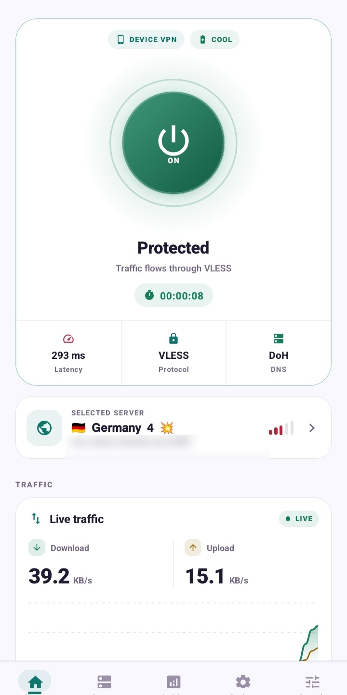

# BaryoVPN

### A focused Android VPN experience built for clarity, control and calm

  
  
  

  <a href="https://github.com/Anooshacavin/BaryoVPN-Android/releases/latest">Get the latest release</a>
  · <a href="SECURITY.md">Security & privacy</a>
  · <a href="https://github.com/Anooshacavin/BaryoVPN-Android/issues">Community issues</a>

---

  

A real BaryoVPN dashboard preview. Private server identifiers are intentionally obscured in the public image.

## The short version

BaryoVPN gives you a calmer way to work with Android VPN connections: a clear home dashboard, an organized server center, practical subscription tools and local connection activity in one focused app.

This repository is the **official public distribution hub** for BaryoVPN Android. It is intentionally separate from other projects and contains release materials for users—not application source code or private implementation details.

## Why users choose it

<table>
<tr>
<td width="50%">

### A dashboard that explains itself

See protection state, selected server, latency, protocol and live traffic without digging through technical screens.

</td>
<td width="50%">

### Subscriptions without the mess

Add, rename, refresh and organize subscription groups with paste, copy, QR scanning, smart naming and HTTPS preview.

</td>
</tr>
<tr>
<td width="50%">

### A confident QR flow

A valid scan ends with a green verification check and Baryo VPN branding before the app continues to the next step.

</td>
<td width="50%">

### Built for large collections

Browse substantial profile libraries with practical organization, local state and performance-minded screens.

</td>
</tr>
</table>

## Latest release · 2.28.7 / Build 259

The latest release introduces a polished QR success confirmation. After a valid scan, BaryoVPN shows its logo, a green verification checkmark and a short validation message before handing off to Add Subscription or Servers.

It also includes the redesigned Subscription Center with one-tap copy and paste, QR scanning, smart naming, HTTPS preview and clearer validation feedback.

### [Download BaryoVPN 2.28.7 for Android →](https://github.com/Anooshacavin/BaryoVPN-Android/releases/latest)

## Install in a few steps

1. Open the [latest release](https://github.com/Anooshacavin/BaryoVPN-Android/releases/latest).
2. Download the APK asset.
3. If Android asks, allow installation from your browser or file manager.
4. Install and open BaryoVPN.
5. Add a subscription or import a supported profile with the in-app tools.

> Download only from this repository or another source you explicitly trust. Android may show a standard warning for an APK installed outside Google Play.

## Why is the APK large?

The release is a **standalone universal APK**, not a tiny development shell. It packages the Android runtime, the complete UI bundle, native connection components, compatibility resources and the assets needed for a direct install.

That means:

- no Metro server or desktop computer is required;
- the same APK is convenient across a wide range of Android devices;
- the full user-facing experience is present after installation;
- the universal package is larger than architecture-specific split packages.

The size is a distribution trade-off. It does **not** mean the app is silently bundling private subscriptions or uploading user data. GitHub Release assets are used because they support large APKs cleanly while keeping version history and download links organized.

## Release timeline

| Version | Highlights |
|---|---|
| **2.28.7** | QR success confirmation with BaryoVPN logo and green verification check |
| **2.28.6** | Subscription Center redesign with copy, paste, QR, smart naming and HTTPS preview |
| **2.28.5** | Security hardening release and safer diagnostics |

## Privacy and public reporting

Please do not post subscription URLs, access tokens, credentials, UUIDs, private keys, raw configuration files or personal data in public issues. Read [SECURITY.md](SECURITY.md) before reporting anything that may be private.

The public repository deliberately contains only user-facing distribution materials. No application source code, source ZIP or private implementation report is published here.

---

**BaryoVPN** · clear status · organized profiles · ready to connect

