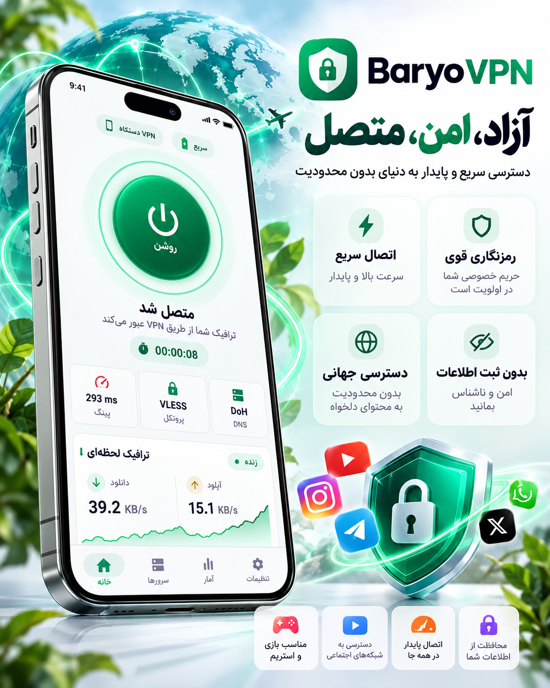

# BaryoVPN

### A focused Android VPN experience built for clarity, control and calm

  
  
  

  <a href="https://github.com/Anooshacavin/BaryoVPN-Android/releases/latest">Get the latest release</a>
  · <a href="SECURITY.md">Security & privacy</a>
  · <a href="https://github.com/Anooshacavin/BaryoVPN-Android/issues">Community issues</a>

---

  

BaryoVPN product overview · clear status, privacy-minded design and live connection insights.

## The short version

BaryoVPN gives you a calmer way to work with Android VPN connections: a clear home dashboard, an organized server center, practical subscription tools and local connection activity in one focused app.

This repository is the **official public distribution hub** for BaryoVPN Android. It is intentionally separate from other projects and contains release materials for users—not application source code or private implementation details.

## What BaryoVPN includes

| Area | User-facing capability |
|---|---|
| **Home dashboard** | Protection state, selected server, latency, protocol, DNS mode and live download/upload traffic in one view. |
| **Server center** | Search, organize and select individual profiles or profiles imported from multiple subscription groups. |
| **Subscription tools** | Add, rename, copy, paste and refresh subscription links with clear update feedback. |
| **QR workflow** | Scan a supported subscription or configuration QR code and receive a green verification confirmation before continuing. |
| **Activity center** | Review connection state, session traffic and local diagnostic events without sending them to a public service. |
| **Large collections** | Designed to stay practical with substantial profile libraries through local organization and efficient updates. |
| **Battery-aware runtime** | Conservative background polling, traffic sampling and recovery behavior to reduce unnecessary CPU work while connected. |
| **Resilience options** | Connection profiles and safeguards designed for unstable or restrictive network conditions, while keeping certificate and leak-protection choices explicit. |

## Supported profile types

BaryoVPN can work with commonly used Xray-based profile formats, depending on the fields provided by the source and the capabilities of the bundled core:

- VLESS, including common Reality and Vision fields
- VMess
- Trojan
- Shadowsocks
- Outline dynamic access keys (`ssconf://`), including prefix disguises
- SOCKS5 and HTTP proxy profiles
- XHTTP transport profiles

The app validates unsupported or incomplete data instead of silently treating it as a working connection. TUIC v5 is not included in the current bundled core; users should not expect a TUIC profile to connect in this release.

## Latest release · 2.29.1 / Build 268

> [!CAUTION]
> **IMPORTANT — PLEASE READ BEFORE INSTALLING:** Uninstall the BaryoVPN version currently on your device, then install BaryoVPN 2.29.1 using the APK attached to the latest release. Uninstalling may erase locally saved profiles and settings; back up anything you need first.

### What’s new in 2.29.1
- Optional password support for `.baryovpn` configuration transfer files.
- Automatic detection of password-protected files during import.
- Modern import result dialogs with clear success and error feedback.
- Profiles and subscription sources refresh immediately after import without restarting the app.
- A dedicated `.baryovpn` import action is available on a fresh installation with no profiles.
- Responsive two-column empty-state actions for better layout on narrow Android screens.
- Improved configuration transfer reliability and user-facing import/export guidance.

### [Download BaryoVPN 2.29.1 for Android →](https://github.com/Anooshacavin/BaryoVPN-Android/releases/latest)

## Install in a few steps

1. Open the [latest release](https://github.com/Anooshacavin/BaryoVPN-Android/releases/latest).
2. Download the APK asset.
3. If Android asks, allow installation from your browser or file manager.
4. Install and open BaryoVPN.
5. Add a subscription or import a supported profile with the in-app tools.

> Download only from this repository or another source you explicitly trust. Android may show a standard warning for an APK installed outside Google Play.

## Why is the APK large?

The current release APK is approximately **213 MiB** because it is a **standalone universal APK**, not a small development shell. It packages everything needed for a direct installation:

- the Android and React Native runtime;
- the complete user interface bundle and application resources;
- the bundled native connection engine;
- native binaries and compatibility data for multiple Android CPU architectures;
- the visual assets required for the complete app experience.

A universal APK is intentionally larger than architecture-specific split packages, but it is simpler for users: one download works across a wider range of Android devices and does not require Metro, a desktop computer or a separate runtime download.

The size is a distribution trade-off. It does **not** mean the app is silently bundling private subscriptions or uploading user data. GitHub Release assets are used because they support large APKs cleanly while keeping version history and download links organized.

## Ownership and permitted use

> [!CAUTION]
> **Ownership notice:** BaryoVPN is an original software product created and maintained by **Ehsan Farzian**.
>
> **Copyright © 2026 Ehsan Farzian. All rights reserved.**
>
> The BaryoVPN name, branding, visual design, user interface, product concept, application builds and related materials are protected intellectual property. Copying, reproducing, modifying, forking, repackaging, decompiling, redistributing, publishing, mirroring, sublicensing, selling or using any part of BaryoVPN for commercial or competing purposes without prior explicit written authorization is prohibited.
>
> Downloading or installing a public APK does not transfer ownership, grant a license to the application, or authorize redistribution. Any authorized use must preserve the original attribution and comply with written terms from the copyright holder.

## Privacy and public reporting

BaryoVPN's public distribution repository does not contain application source code, source archives, private implementation reports or user subscription data. Please do not post subscription URLs, access tokens, credentials, UUIDs, private keys, raw configuration files or personal data in public issues. Read [SECURITY.md](SECURITY.md) before reporting anything that may be private.

## Release timeline

| Version | Highlights |
|---|---|
| **2.29.1** | Optional `.baryovpn` passwords, immediate import refresh and responsive empty-state actions |
| **2.28.14** | Outline dynamic keys and prefix support, plus clearer connection diagnostics |
| **2.28.8** | Bug Fix release with stability and connection improvements |
| **2.28.7** | QR success confirmation with BaryoVPN logo and green verification check |
| **2.28.6** | Subscription Center redesign with copy, paste, QR, smart naming and HTTPS preview |
| **2.28.5** | Security hardening release and safer diagnostics |

---

**BaryoVPN** · clear status · organized profiles · ready to connect

